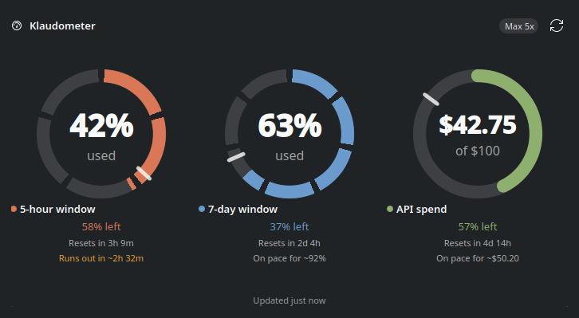
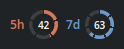
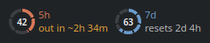
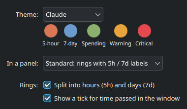
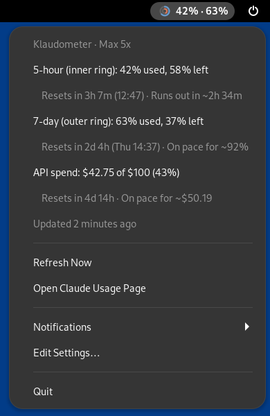
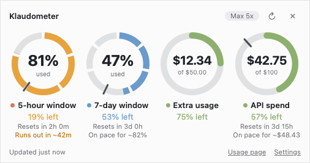

# Klaudometer

Shows how much of your Claude subscription's **5-hour** and **7-day** limits you've used.
It can also show your subscription's **extra usage** and your **Claude API spend** for the month.

It comes in three forms:

- **A KDE Plasma 6 widget** for the desktop and panel. That's most of this README.
- **A [tray icon](#tray-icon-gnome-xfce-cinnamon-and-others)** for GNOME, XFCE, Cinnamon, MATE,
  Budgie, LXQt and Plasma 5.
- **An [app for macOS and Windows](#macos-and-windows)** in the menu bar or system tray.

> **Unofficial.** Klaudometer isn't made by, affiliated with or endorsed by Anthropic. Read the
> [disclaimer](#disclaimer) before using it.

## Screenshots

<p align="center">
  
</p>

<p align="center">
  
  &nbsp;&nbsp;
  
</p>

<p align="center">
  
  &nbsp;
  
</p>

<p align="center">
  
  <br>
  
</p>

All screenshots use made-up numbers.

## Plasma widget

- **Desktop:** a card with one ring per meter, how much is left, and when each one resets.
- **Panel:** small rings with the percentage inside. Click to open the card,
  middle-click to refresh, hover for details.

Telling the meters apart:
- The **5-hour** ring is split into 5 segments, one per hour, and the **7-day** ring into 7, one per day.
  Money rings (extra usage, API spend) are continuous.
- Each meter has its own colour, and the `5h` / `7d` / `Extra` / `API` labels and title dots match it.
- The small tick on a ring marks how much of that window's (or month's) *time* has passed. If the arc
  is behind the tick, you're using it slower than the limit allows.

Rings switch to the warning colour at 75% and to the critical colour at 90% (both adjustable).

**Pace:** each meter projects where you'll end up at your average rate so far, for example
"On pace for ~82%", or "Runs out in ~42m" in the warning colour when you'll hit the limit
before it resets. It appears once a tenth of the window (or month) has passed, so early
guesses aren't noise. In the panel's *Detailed* style, "out in ~42m" replaces the reset time
when that's the more urgent news.

## Requirements

The widget runs on any distro with **KDE Plasma 6**. On other desktops, or on Plasma 5, use the
[tray icon](#tray-icon-gnome-xfce-cinnamon-and-others) instead.

| Distro | Plasma | Status |
|---|---|---|
| Fedora 44 KDE | 6.7 | Developed and run here |
| Kubuntu / Ubuntu 26.04 LTS | 6.6 | Everything needed comes with `kubuntu-desktop` |
| Debian 13 (trixie) | 6.3 | Everything needed comes with `kde-plasma-desktop` |
| Arch Linux, Manjaro, EndeavourOS | 6.8 | Everything needed comes with `plasma-desktop` |
| openSUSE Tumbleweed | 6.8 | Everything needed comes with the `kde_plasma` pattern |
| openSUSE Leap 16 | 6.4 | Ships Plasma 6, so it should work; packages not checked |
| Kubuntu 24.04 LTS, Debian 12 | 5.27 | **Not supported** (Plasma 5); use the tray icon |
| Kubuntu 22.04 LTS | 5.24 | **Not supported** (Plasma 5); use the tray icon |

The widget itself has only been run on Fedora. For the other distros, I checked that each
standard Plasma install includes every package the widget needs, and ran the helper under that
distro's own Python (3.13 to 3.14).

`secret-tool` is the one thing no standard install includes. You only need it to keep the Admin
API key for [API spend](#claude-api-spend) in your wallet.

On a minimal install, `./install.sh --check` lists anything missing along with the command to
install it. The full set for each distro:

**Debian / Ubuntu**

```bash
sudo apt install python3 qml6-module-org-kde-plasma-plasma5support qml6-module-qtquick-shapes qml6-module-org-kde-kcmutils qml6-module-org-kde-kquickcontrols qml6-module-org-kde-notifications libsecret-tools
```

**Fedora**

```bash
sudo dnf install python3 plasma5support qt6-qtdeclarative kf6-kcmutils kf6-kdeclarative kf6-knotifications libsecret
```

**Arch**

```bash
sudo pacman -S python plasma5support qt6-declarative kcmutils kdeclarative knotifications libsecret
```

**openSUSE**

```bash
sudo zypper install python3 plasma5support6 qt6-declarative-imports kf6-kcmutils-imports kf6-kdeclarative-imports kf6-knotifications-imports secret-tool
```

The notifications package and `secret-tool` are optional. Without the first, alerts are off.
Without the second, the Admin API key can go in a private file instead (see API spend).
Everything else works either way.

## Install / update

```bash
./install.sh
```

The installer checks for Plasma 6 and the packages above first, then installs the widget for
your user. It uses `kpackagetool6` if it's there, or copies the widget into
`~/.local/share/plasma/plasmoids/` if not. Then right-click the desktop or panel, choose
**Add or Manage Widgets**, and pick **Klaudometer**.

**From a release:** download `klaudometer-<version>.plasmoid` from the Releases page. Then right-click
the desktop and choose **Add or Manage Widgets › Get New › Install Widget From Local File…**, or run
`kpackagetool6 -t Plasma/Applet -i klaudometer-<version>.plasmoid`. This skips the installer's
dependency check, so if the widget won't load, run `./install.sh --check` from a source copy.

Each panel and desktop gets its own copy with its own settings. After an update, run
`systemctl --user restart plasma-plasmashell` so widgets already placed pick up the new code.

To build the `.plasmoid` yourself, run `./build.sh`; it writes `dist/klaudometer-<version>.plasmoid`.

Uninstall: `kpackagetool6 -t Plasma/Applet -r io.github.ajacks-595.klaudometer`, or delete
`~/.local/share/plasma/plasmoids/io.github.ajacks-595.klaudometer`.

## Settings

Right-click the widget and choose **Configure Klaudometer…**

**General**
- How often to check (default every 3 minutes)
- What to show: the 5-hour window, the 7-day window, and extra usage (only appears while extra usage is turned on for your plan)
- Whether numbers show usage *used* or usage *left*
- Whether to show the pace projection (on by default)
- Warning and critical levels, used for ring colours and notifications (colour changes can be turned off)

**Appearance**
- Theme: Claude, Plasma accent (follows your colour scheme), Ocean, Sunset, Forest, Monochrome, or Custom (pick all five colours)
- Panel style:
  - *Minimal*: rings only
  - *Standard*: rings with labels
  - *Detailed*: labels plus reset countdowns, or amounts for money meters
- Ring segments and the time-passed tick can each be turned off
- Desktop background style (standard, translucent, none) is in the widget's own handle menu.

**Spending**
- Show this month's Claude API spend against a monthly budget you set (default $100)
- Shows whether your Admin API key was found, and the command to store it

**Notifications**
- A desktop notification when a meter reaches the warning or critical level (on by default).
  For API spend the levels are a share of your budget.
- A notification when a meter is on pace to run out before it resets (off by default)
- A notification when a window resets (off by default)
- A *Send Test Notification* button
- Each alert is sent once per window or month, even with the widget on several panels. The copies share a
  record in `~/.cache/klaudometer/notified.json`, so a restart or re-login doesn't repeat alerts.
  Changing a level counts as a new alert.

## Claude API spend

API spend comes from your Console organization's
[cost report](https://platform.claude.com/docs/en/manage-claude/usage-cost-api), which updates within
a few minutes. It needs an **Admin API key** (`sk-ant-admin01-…`). Individual Console accounts can't
create one; set up an organization first. Create the key at
[platform.claude.com/settings/admin-keys](https://platform.claude.com/settings/admin-keys), then store it
in your wallet (KDE Wallet or GNOME Keyring):

```bash
secret-tool store --label='Klaudometer Admin API key' service klaudometer key admin
```

Paste the key when it asks for a password. Klaudometer reads the key from the wallet each time it checks,
and never writes it to a file. The console has no API for its spend limit, so the budget is the one you
set in the widget.

If your system has no wallet service, put the key on its own in `~/.config/klaudometer/admin-key` and
make the file private with `chmod 600 ~/.config/klaudometer/admin-key`. Klaudometer refuses a key file
that other users can read.

## Tray icon (GNOME, XFCE, Cinnamon and others)

For desktops that can't run Plasma widgets, Klaudometer can sit in the system tray instead. It works
anywhere that shows StatusNotifierItem / AppIndicator tray icons: GNOME (with the AppIndicator
extension), XFCE, Cinnamon, MATE, Budgie, LXQt and KDE Plasma 5 or 6.

- **Icon:** two rings, the 5-hour window inside and the 7-day window outside. They use the same
  colours as the widget and switch to the warning or critical colour as usage rises.
- **Label:** on GNOME the percentages appear next to the icon, for example `32% · 70%`. KDE and XFCE
  show only the icon; the numbers are always in the menu.
- **Menu:** each meter's usage, reset time and pace, plus extra usage and API spend if you use
  them. It also has Refresh Now, a link to Claude's usage page, notification toggles, and
  Edit Settings….
- **Notifications:** the same alerts as the widget. They share the widget's record of what's been
  sent, so running both never doubles up.

```bash
tray/install.sh
```

This checks what's needed, installs to `~/.local/share/klaudometer-tray/`, adds a menu entry, starts
the icon, and starts it again whenever you log in. Other options: `tray/install.sh --check` only
checks, `--no-autostart` skips the login start, and `--uninstall` removes it (your settings stay).

I checked that the installer's package list installs cleanly and the icon's code runs on Debian 12 and
13, Ubuntu 22.04, 24.04 and 26.04, Fedora 44, Arch, and openSUSE Tumbleweed and Leap 16 (Python 3.10
to 3.14).

**Packages it needs** (most GNOME desktops already have them):

| Distro | Packages |
|---|---|
| Debian, Ubuntu | `python3-gi gir1.2-gtk-3.0 gir1.2-ayatanaappindicator3-0.1` |
| Fedora | `python3-gobject gtk3 libayatana-appindicator-gtk3` |
| Arch | `python-gobject gtk3 libayatana-appindicator` |
| openSUSE | `python3-gobject python3-gobject-Gdk typelib-1_0-Gtk-3_0 typelib-1_0-AyatanaAppIndicator3-0_1` |

**GNOME needs the AppIndicator extension** to show any tray icon:
- **Ubuntu:** ships it turned on.
- **Fedora, Debian and Arch:** install `gnome-shell-extension-appindicator`, log out and back in,
  then turn it on in the Extensions app.
- **openSUSE:** get "AppIndicator and KStatusNotifierItem Support" from extensions.gnome.org.

The installer warns you if it's off.

**Settings** live in `~/.config/klaudometer/tray.ini`; open it from Edit Settings… in the menu.
You can choose what to show, used or left, the label style, theme or single colours, warning
levels, pace, and notifications. Changes apply within about 20 seconds.

`python3 tray/klaudometer_tray.py --print` prints the current status once, without a tray, which
is handy for scripts or a terminal.

## macOS and Windows

On a Mac, Klaudometer sits in the menu bar. On Windows, it sits in the system tray.

- **Icon:** the same two rings as the Linux tray icon. On a Mac the percentages appear beside it,
  for example `5h 81% · 7d 47%`.
- **Card:** click the icon for the rings, how much is left, reset times and pace, as on the
  widget's desktop card.
- **Menu:** right-click the icon for each meter's details, Refresh Now, Claude's usage page,
  Settings and Quit.
- **Settings:** which meters to show, used or left, themes, colours and levels, notifications, and
  start at login. The Spending page saves your Admin API key in the Keychain or Windows Credential
  Manager.
- **Notifications** at the warning and critical levels, when you're on pace to run out, and when a
  window resets, as on Linux.

### Install

Klaudometer reads the login of Claude Code on the same computer, so install Claude Code and log in
first. Then download from the [Releases page](https://github.com/ajacks-595/klaudometer/releases):

- **macOS 11 or later** (Apple silicon or Intel): `Klaudometer_<version>_universal.dmg`. Open it
  and drag Klaudometer into Applications.
- **Windows 10 or 11:** `Klaudometer_<version>_x64-setup.exe` installs just for you, without
  administrator rights. `Klaudometer_<version>_x64_en-US.msi` installs for everyone on the PC.

The builds aren't signed yet, so the first launch takes one extra step:

- **macOS** says Klaudometer can't be opened. Go to **System Settings › Privacy & Security** and
  choose **Open Anyway**.
- **Windows** SmartScreen may warn about an unknown publisher. Choose **More info › Run anyway**.
  Windows 11 puts new tray icons behind the **^** by the clock, so drag Klaudometer's icon onto the
  taskbar to keep it in view.

To start Klaudometer when you log in, tick **Start at login** in its settings.

To uninstall, choose **Quit Klaudometer** from its menu. Then on a Mac, drag it from Applications
to the Trash. On Windows, remove it in **Settings › Apps**. Where it keeps its settings and cache is
listed in [desktop/README.md](desktop/README.md#where-things-live), along with how to build it.

## How it gets the numbers

`package/contents/code/fetch_usage.py` does all the fetching for both the widget and the tray icon.
It only talks to `api.anthropic.com`, and there's no telemetry.

- **Subscription limits and extra usage:** it reads the login Claude Code stores in
  `~/.claude/.credentials.json` and calls `https://api.anthropic.com/api/oauth/usage`, the same
  endpoint Claude Code's `/usage` screen uses. The endpoint isn't documented, so it could change.
  The widget never refreshes your login token itself, because that could log Claude Code out.
  If the token has expired, it runs `claude auth status` and shows the last known values until
  Claude Code has a fresh token.
- **API spend:** `GET /v1/organizations/cost_report` for the current month (UTC), checked at most
  every 10 minutes.
- Results are cached in `~/.cache/klaudometer/`, so every copy of the widget shares a single request.
- You can run it by hand: `python3 package/contents/code/fetch_usage.py --sources sub,api`.
  For testing, `KLAUDOMETER_API_BASE` points it at another server, and `ANTHROPIC_ADMIN_KEY`
  overrides the wallet.
- The macOS and Windows app does the same in Rust (`desktop/core`). On a Mac it reads Claude Code's
  login from the Keychain, where Claude Code keeps it. On Linux it shares the widget's cache and alert
  record, so each alert is sent only once whichever front ends you run.

## Known limitations

- **API spend and extra usage** have only been tested against a stand-in for Anthropic's API.
  Neither has run with a real Admin API key or with extra usage actually turned on.
- **Expired logins:** if Claude Code isn't used for a few hours, its login token expires. Klaudometer
  runs `claude auth status`, but it hasn't been confirmed whether that renews the token. Opening
  Claude Code always does, and the widget catches up on its next check.
- **Display:** the widget has been checked in a dark theme at 100% scaling. Light themes and high-DPI
  scaling haven't been checked yet.
- **Not shown yet:** per-model weekly limits (Opus, Sonnet) on Max plans.
- **Notifications** from the Plasma widget name "Plasma" as the sender.
- **Tray labels:** KDE and XFCE show only the tray icon, not the text label next to it.
- **macOS and Windows app:** it has been tested on GitHub's Mac and Windows build machines, against a
  stand-in for Anthropic's API. It hasn't yet been tried with a real account on a real Mac or PC.
  The builds aren't signed, so macOS and Windows warn the first time it runs.

## Disclaimer

Klaudometer is an unofficial, independent project. It isn't made, endorsed or supported by Anthropic.
"Claude" and "Claude Code" are trademarks of Anthropic, used here only to say what Klaudometer works with.

- **Undocumented endpoint:** the subscription numbers come from an endpoint Claude Code itself uses,
  which Anthropic doesn't document. It can change or stop working at any time.
- **Your Claude Code login:** to fetch those numbers, Klaudometer reads the login Claude Code stores on
  your computer and sends it only to `api.anthropic.com`, the same place Claude Code sends it. It never
  stores, copies or sends the login anywhere else, and it never refreshes it.
- **Anthropic's terms:** these describe Claude Code's login as intended for Claude Code and
  Anthropic's own apps. Klaudometer is neither, so use the subscription meters at your own risk.
- **API spend:** this uses your own Admin API key, and the terms explicitly allow managing your own
  API keys.
- **No telemetry:** the only network requests go to `api.anthropic.com`.

Klaudometer is provided as is, without warranty of any kind. See the [license](LICENSE).

## License

[MIT](LICENSE) © 2026 Alex Jackson
